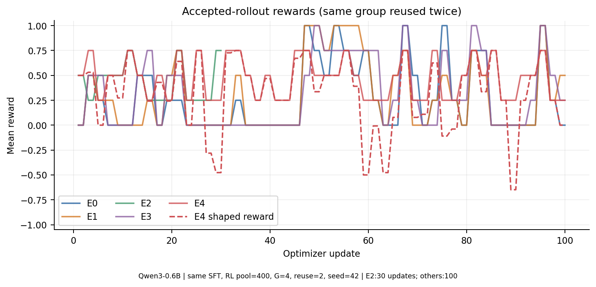
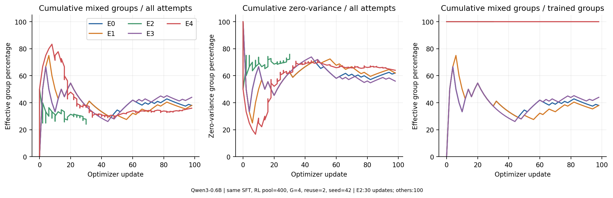
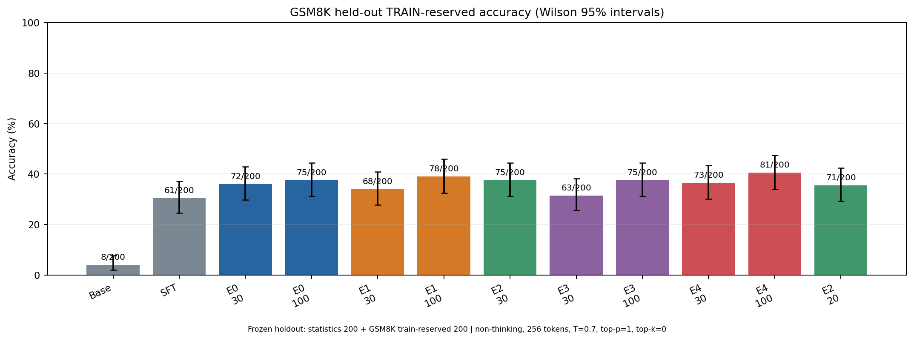
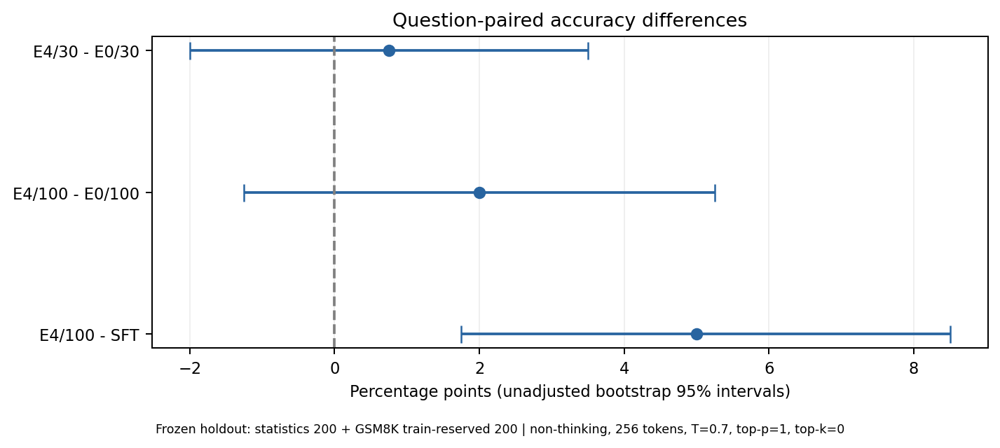

# StatReason-RL

面向数学推理的Qwen小模型可验证奖励强化学习与GRPO/DAPO机制分析。

项目基于TRL、Transformers和PEFT，在RTX 5060 Laptop 8GB上完成SFT、受控GRPO/DAPO训练与统一评测。重点研究有效奖励组、裁剪行为、长度归一化和采样成本。训练器基于TRL集成，数据、验证、在线补采、长度整形及审计由项目实现。

## 系统与实现

| 模块 | 代码与职责 |
|---|---|
| 数据 | src/data：GSM8K处理、统计题生成、独立数值校验、分组隔离 |
| 奖励 | src/rewards/numeric.py：唯一最终标量、容差、格式与截断防护 |
| SFT | src/training/sft*.py：助手标签mask、LoRA、检查点验证 |
| GRPO审计 | grpo_trainer.py、grpo_math.py：旧/参考概率、损失与Token指标 |
| DAPO适配 | dapo_mechanisms.py：在线补采、长度奖励、非对称裁剪与Token损失接入 |
| 评测统计 | src/evaluation：冻结协议、逐题输出、配对统计与图表 |

固定SFT → G=4 Rollout → 严格奖励 → 可选在线筛选/补采 → 相对优势 → TRL裁剪目标与KL → LoRA更新 → 冻结评测。每批旧概率复用两次，参考策略为独立冻结的同一SFT副本。

## 数据和协议

原v1统计题900条、28个模板族，按模板族划分SFT/RL/validation/test，标准答案由确定程序计算并独立校验。GSM8K官方train共7473条，固定版本与来源指纹。主SFT使用GSM1000条、统计200条，训练300步后导出验证loss选中的150步。RL共同池400题：GSM300、统计100。

最终评测400题：封存统计200题全部保留，另含GSM8K train的reserved题200道，**不是官方GSM8K test成绩**。相关数学结构出现在历史扩展开发中，不宣称完全未知结构泛化。原100题只作开发使用。最终评测后停止调参。

所有模型使用同一官方Non-thinking模板、256 Token、temperature=0.7、top_p=1、top_k=0、batch=4，每题采样一次。严格正确率、数值正确率、格式有效率、截断与成本分开记录。没有pass@8结果。

## 实验设计

| 组别 | 变化 | 实际更新步数 |
|---|---|---:|
| E0 | Vanilla GRPO，回答归一化，对称裁剪 | 100 |
| E1 | 仅上裁剪epsilon 0.20→0.28 | 100 |
| E2 | 仅在线Dynamic Sampling | 30，达到预定补采上限停止 |
| E3 | 仅全局有效Token归一化 | 100 |
| E4 | 四机制组合，包括超长奖励 | 100 |

各组固定初始SFT、RL池、LoRA、优化器、学习率1e-5与KL系数0.04；E4保留共同KL，是受控四机制适配，不是论文去KL的大规模配方。五组共同30步公平比较，四个100步终点另列。生成成本受限比较按Token而非准确率选择保存检查点，明确离散预算差。

## 真实结果

| 模型 | 全部400题 | GSM train-reserved/200 | 统计/200 |
|---|---:|---:|---:|
| Base | 9/400 (2.25%) | 8 | 1 |
| SFT | 64/400 (16.00%) | 61 | 3 |
| E0_step100 | 76/400 (19.00%) | 75 | 1 |
| E1_step100 | 80/400 (20.00%) | 78 | 2 |
| E2_step30 | 78/400 (19.50%) | 75 | 3 |
| E3_step100 | 81/400 (20.25%) | 75 | 6 |
| E4_step100 | 84/400 (21.00%) | 81 | 3 |

E4相对Vanilla点估计+2.00个百分点，题目级配对Bootstrap 95%区间[-1.25,5.25]跨0，不能宣称DAPO显著优于GRPO。E4相对SFT点估计+5.00个百分点，未调整区间[1.75,8.50]；同时报告多重比较校正，单种子不支持跨seed稳健结论。

E4接受训练的有效组比例100%，E0为38%，但总生成Token为44,832与16,157，约2.77倍。E1上侧有效裁剪仅约0.0096%，E4有53个接受回答触发长度惩罚。统计正确率仍低，实验结论采用机制分析路线，不包装成全面数学能力提升。






完整12检查点表、训练与成本曲线、Wilson区间、配对Bootstrap、McNemar与Holm校正见[实验报告](reports/ablation_round1/final_report.md)。原始回答位于outputs/ablation_evaluation_round1，训练日志与代码快照位于outputs/runs。

## 复现

环境：Windows、Python 3.13、PyTorch 2.8.0+cu128、Transformers 4.57.1、TRL 0.23.1、PEFT 0.17.1、Accelerate 1.10.1。依赖锁文件为requirements.lock.windows-py313-cu128.txt；安装与基础训练见docs/training_guide.md。模型权重和虚拟环境不提交。

```powershell
.venv\Scripts\python.exe scripts/07_train_grpo.py --config configs/ablations/E0_100.yaml
.venv\Scripts\python.exe scripts/24_run_ablations.py --status
.venv\Scripts\python.exe scripts/26_evaluate_ablations.py --execute
.venv\Scripts\python.exe scripts/27_finalize_ablation_report.py
```

训练日志自动保存，批量运行入口提供中文进度；评测可中断后用同一命令续跑。已有完整运行会保留，配置、代码、数据或权重改变时应建立新实验版本。完整运行与迁移说明见[运行指南](docs/training_guide.md)。

## 验证与局限

覆盖严格奖励边界、不同长度和Padding损失、实际TRL梯度累积、补采预算与停止、生成配置回退、冻结测试ID及配对统计。所有正式运行有224个LoRA张量变化与重载证据；Vanilla与E4短程恢复通过同机逐位一致性校验。

局限包括单训练种子、每题单样本、较弱统计迁移、E2提前停止、成本匹配存在离散剩余、缺少独立E5长度消融，以及共享模板相关性。没有证实熵坍塌，也没有证明Clip-Higher单独改善探索。项目达到预算受限机制分析目标后停止扩展，不用最终测试集继续优化。

参考：[TRL 0.23.1](https://huggingface.co/docs/trl/v0.23.1/grpo_trainer)、[Open-R1](https://github.com/huggingface/open-r1)、[Qwen2.5-Math](https://github.com/QwenLM/Qwen2.5-Math)、[DAPO官方项目](https://dapo-sia.github.io/)、[论文](https://arxiv.org/abs/2503.14476)。
