# StatReason-RL：GRPO/DAPO受控机制实验报告

本文报告预算受限条件下的GRPO/DAPO受控机制实验。结论基于真实训练、统一判题和完整结果校验，不宣称复现论文规模或证明DAPO显著优于GRPO。

## 模型、数据与方法

Qwen3-0.6B，BF16/SDPA，RTX 5060 Laptop 8GB。LoRA r=8、alpha=16，q/k/v/o四类投影，共224个可训练张量、2,293,760参数。共用同一个SFT适配器（SFT运行300步，验证loss选择150步），RL池400题：GSM300、统计100。

基于TRL 0.23.1集成Rollout、裁剪与损失，项目实现奖励、独立SFT参考、在线补采、长度整形、数学审计和统计分析；不是从零手写整个Trainer。每组独立初始化，G=4、旧概率复用2次、LR=1e-5、beta=0.04、种子42。E0显式loss_type=grpo；E1上裁剪0.28；E2在线筛选；E3 token损失；E4四机制组合。E4保留共同KL，区别于论文去KL的完整配方。

统一评测固定12个检查点×400题，每题一次采样：Non-thinking、256 Token、温度0.7、top_p=1、top_k=0、batch=4。统计200题全部保留；GSM200题来自官方train的reserved划分，不是官方test成绩。原100题已降为开发集；本轮最终结果不再用于继续调参。

400道独立记录包含相关模板与技能，因此不宣称完全未知结构泛化；一训练种子、一评测采样不能覆盖跨种子不确定性。结构难度分层为basic57、medium28、complex115，GSM难度不猜测。

## 完整评测

| 模型 | 严格正确 | GSM/200 | 统计/200 | 格式有效 | 截断 |
|---|---:|---:|---:|---:|---:|
| Base | 9/400 (2.25%) | 8 | 1 | 74.75% | 0.00% |
| SFT | 64/400 (16.00%) | 61 | 3 | 95.25% | 2.25% |
| E0_step30 | 73/400 (18.25%) | 72 | 1 | 93.00% | 4.00% |
| E0_step100 | 76/400 (19.00%) | 75 | 1 | 91.00% | 4.00% |
| E1_step30 | 71/400 (17.75%) | 68 | 3 | 92.25% | 3.75% |
| E1_step100 | 80/400 (20.00%) | 78 | 2 | 91.75% | 3.50% |
| E2_step30 | 78/400 (19.50%) | 75 | 3 | 96.00% | 2.00% |
| E3_step30 | 66/400 (16.50%) | 63 | 3 | 94.75% | 1.25% |
| E3_step100 | 81/400 (20.25%) | 75 | 6 | 94.50% | 3.50% |
| E4_step30 | 76/400 (19.00%) | 73 | 3 | 94.75% | 2.25% |
| E4_step100 | 84/400 (21.00%) | 81 | 3 | 93.00% | 4.25% |
| E2_step20 | 75/400 (18.75%) | 71 | 4 | 95.75% | 2.00% |

严格正确、数值正确和格式有效分别记录，完整分题型、分结构难度、Wilson区间与资源见results.json、ablation_summary.csv和逐题JSONL。不能把4800条回答当作4800道独立试题；统计单位为同一400题配对。未进行pass@8评测。

## 配对统计

| 比较 | 差值（百分点） | 未调整配对Bootstrap 95%区间 | McNemar p | Holm p |
|---|---:|---:|---:|---:|
| SFT_vs_Base | +13.75 | [+10.00, +17.50] | 4.8696e-13 | 6.8174e-12 |
| E4_step100_vs_SFT | +5.00 | [+1.75, +8.50] | 0.0055152 | 0.071698 |
| E4_step100_vs_E0_step100 | +2.00 | [-1.25, +5.25] | 0.27996 | 1 |
| E4_step30_vs_E0_step30 | +0.75 | [-2.00, +3.50] | 0.72833 | 1 |

Bootstrap按题目配对重采样10000次，种子42，同时保存按来源分层的区间。Holm校正覆盖14项探索性比较；未调整区间为正不等于整组多重比较校正后显著。

E4相对SFT的点估计提升来自GSM题，统计题均3/200。E4相对Vanilla的区间跨0，不能宣称DAPO显著优于GRPO。共同30步比较同样没有清晰优势。单个最高分检查点不作为新一轮训练选择依据。

## 机制行为与成本

| 组别 | 实际步数 | 尝试/接受组 | 原始有效率 | 接受组有效率 | 总生成Token | 额外补采Token |
|---|---:|---:|---:|---:|---:|---:|
| E0 | 100 | 50/50 | 38.00% | 38.00% | 16157 | 0 |
| E1 | 100 | 50/50 | 38.00% | 38.00% | 15652 | 0 |
| E2 | 30 | 62/15 | 24.19% | 100.00% | 20609 | 15231 |
| E3 | 100 | 50/50 | 44.00% | 44.00% | 15241 | 0 |
| E4 | 100 | 139/50 | 35.97% | 100.00% | 44832 | 28903 |

在线筛选使E4用于训练的原始混合奖励组比例达到100%，但总生成成本为E0的2.77倍。额外补采Token与丢弃Token集合重叠，不能相加当作总成本。E2连续9组无差异而停在30步，尾部2733 Token未用于新更新，仍计入成本。

接受组100%有效是筛选定义保证的结果，并非全部候选题的正确率。E1上侧有效裁剪仅约0.0096%，E0约0.0217%；裁剪很少，不能宣称缓解熵坍塌。E3的token聚合及梯度累积归一化通过实际TRL方法和GPU损失独立核对。E4有53个接受回答受到长度惩罚，证明该机制参与真实训练；组合效果不能单独归因于长度奖励。没有额外E5，因此缺少独立长度消融。

熵来自各组实际采样的题目和Token，动态筛选改变样本组成；均值差异不是固定探针分布上的探索能力差异。当前日志不足以证实策略熵坍塌。相同奖励组也可能有KL更新，不能将零优势等同于所有参数梯度为零。

## 公平比较与预算限制

五组共同30步比较，四组100步终点单列，E2/100标为缺失。按生成Token选取预算受限检查点，不使用准确率选择。

| 成本比较对象 | 实际Token | E0/100预算 | 未用预算差 |
|---|---:|---:|---:|
| E2_step20 | 11459 | 16157 | 4698 |
| E4_step30 | 12975 | 16157 | 3182 |

因每10步保存，成本只是同一上限约束，不是实际Token完全相等；不能据此声称严格等成本优越。所有停止与失败记录保留。时间受电脑负载、预热和温度影响，Token成本更适合主要效率比较。

## 正确性与错误案例

重新严格判题全部4800条评测回答，与保存结果一致；200道统计标准答案独立计算通过，最大绝对误差4.44e-14。这不代表所有GSM答案都经独立人工证明。

代表性错误包括：指标变量方差没有正确代入p(1-p)；相关样本均值标准误遗漏或错算协方差；将条件独立误当成无条件独立的贝叶斯题。对应原文保存在error_cases.jsonl。高格式有效率与极低统计正确率同时出现，说明本轮领域推理缺陷没有解决；不会通过放宽容差、删除难题或继续使用测试集调参修饰结果。

## 图表

汇总图09的RL Token列以及ablation_summary.csv的training_generated_tokens_at_checkpoint列均统计截至各检查点的累计生成量；成本图08与上文总成本表统计完整运行。E2第30步检查点为17,876 Token，停止前额外补采2,733 Token未进入新更新，完整运行合计20,609 Token。

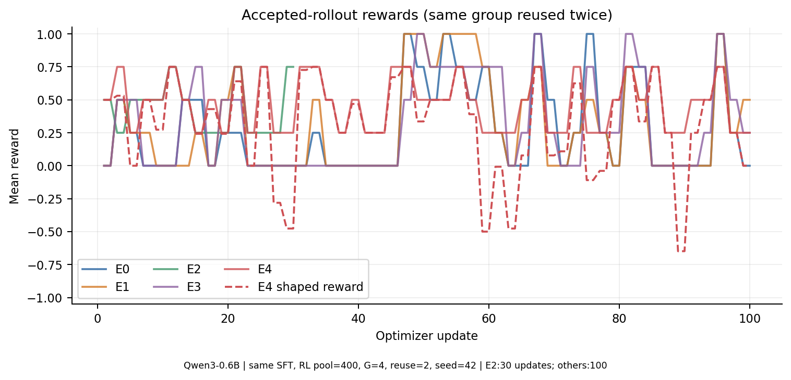

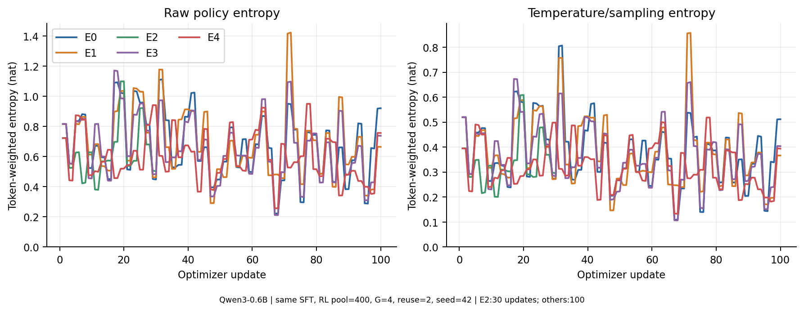

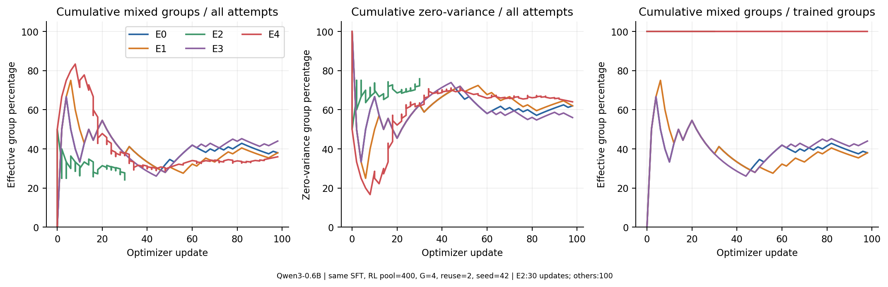

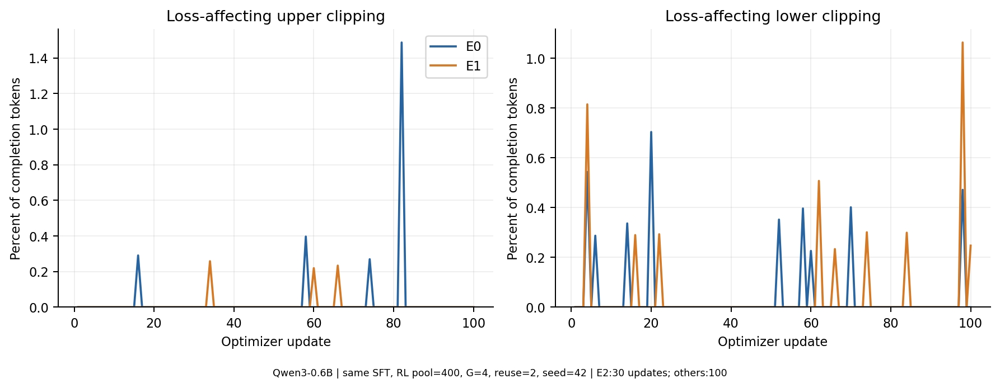

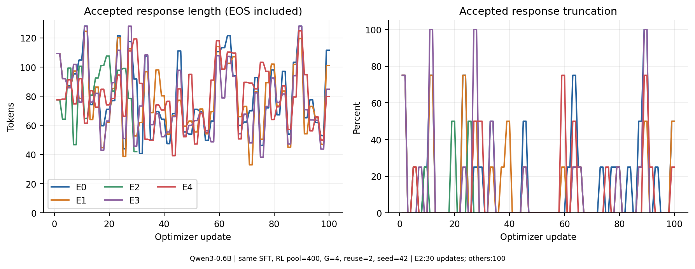

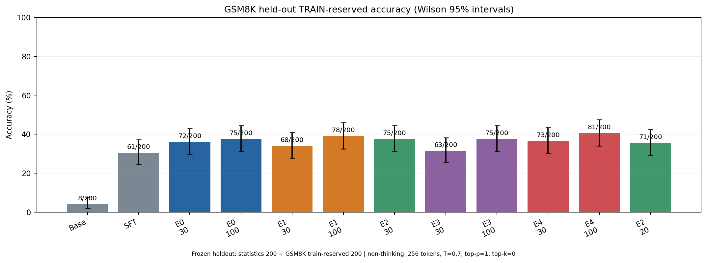

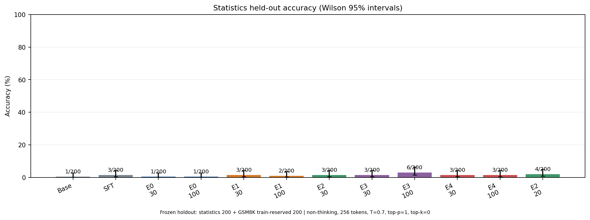

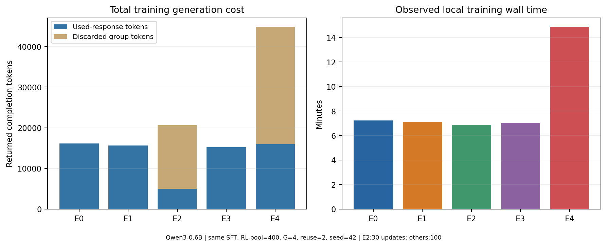

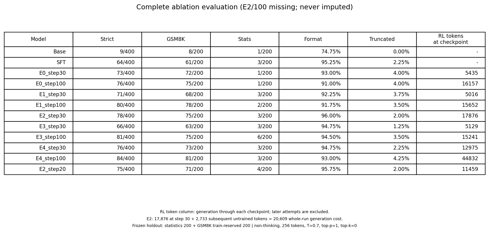

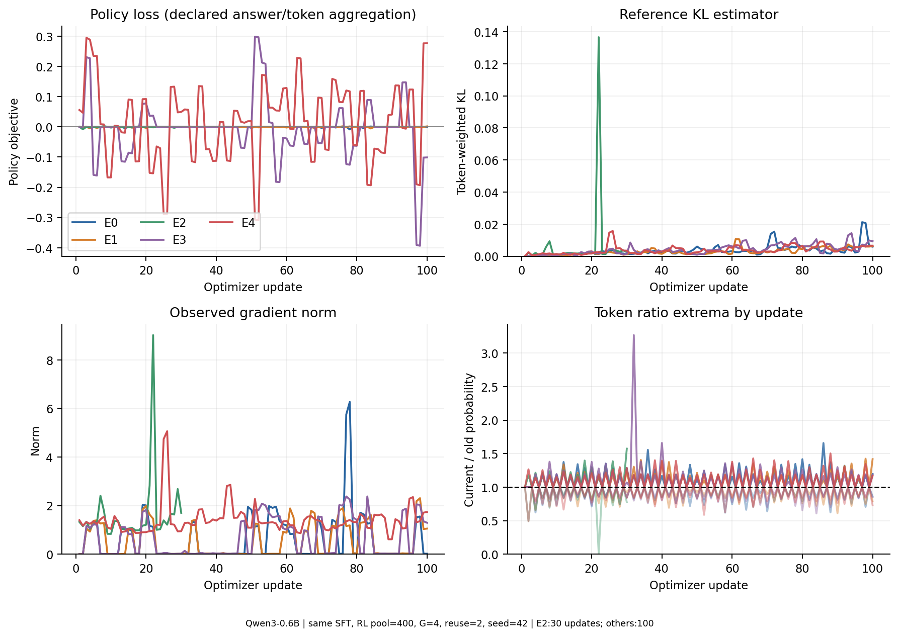

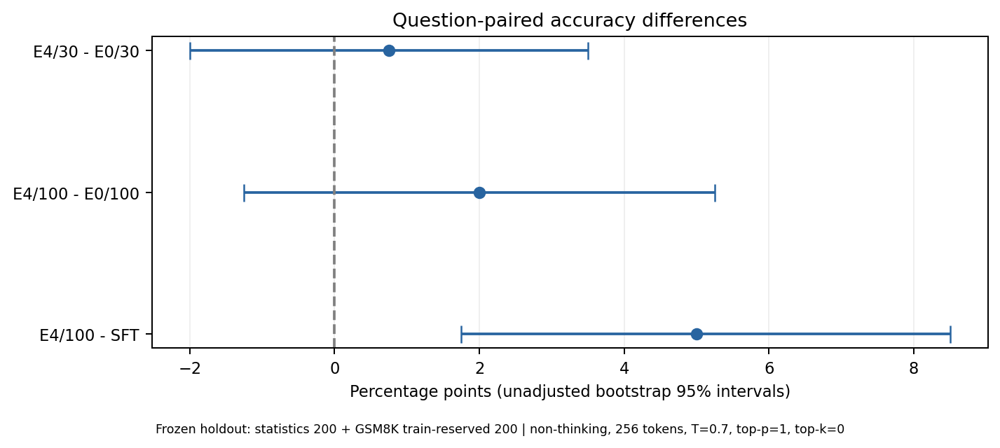

图中直接显示原始更新序列，没有挑选有利区间；奖励每两次更新共用一组样本。准确率图从0开始，显示完整0–100%范围和Wilson区间。E2曲线在30步结束，不延长或补造至100步。

## 复现与公开产物

公开仓库提供代码、配置、依赖、测试、报告、CSV、结果JSON、图表和少量错误样例。完整原始回答、训练审计、冻结计划、处理后数据及模型/适配器检查点保存在本地，未随仓库分发。阅读公开结果无需模型；以下命令仅适用于已具备完整本地实验产物的环境。重新审计不能仅依赖结果JSON，具体前置条件见[运行指南](../../docs/training_guide.md)。

```powershell
.venv\Scripts\python.exe scripts/24_run_ablations.py --status
.venv\Scripts\python.exe scripts/26_evaluate_ablations.py --execute
.venv\Scripts\python.exe scripts/27_finalize_ablation_report.py
```

报告、CSV、PNG和本地校验清单均由保存的真实运行记录生成。公共结果表与完整运行的计算成本分别注明统计口径，未对失败样本或提前停止运行作删除或补造。

本轮结论限定为预算受限的机制分析。后续可在新增独立开发/测试数据与额外预算下研究多种子、更强数学底座、严格等Token更新和独立长度消融。当前测试集不得再用作模型选择。
